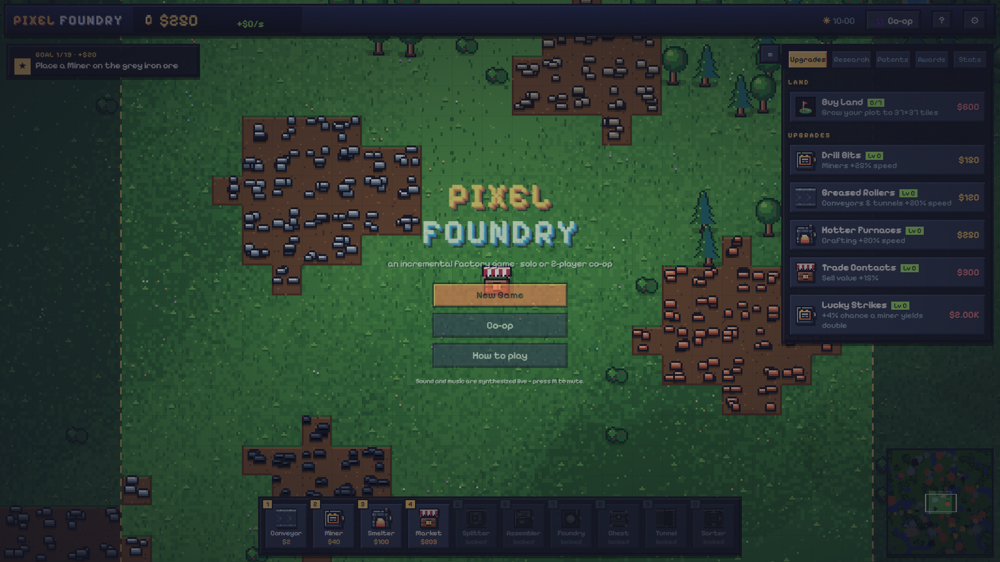
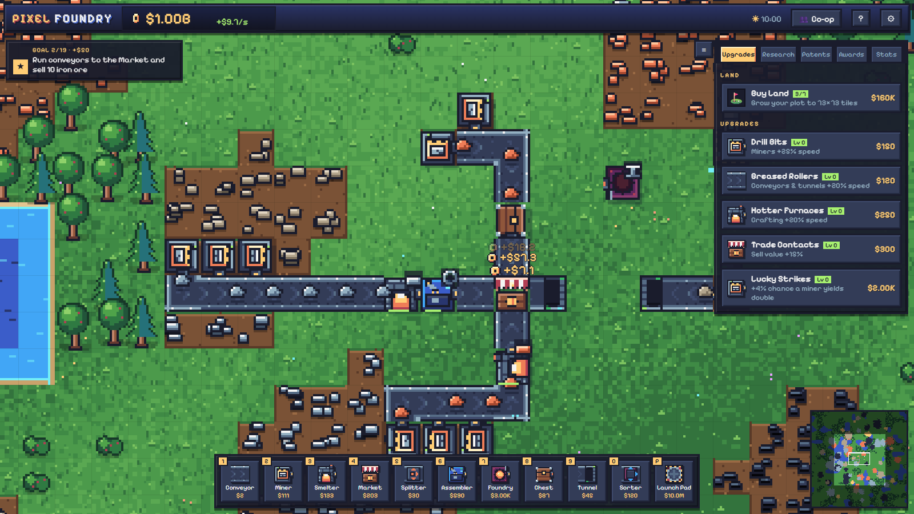
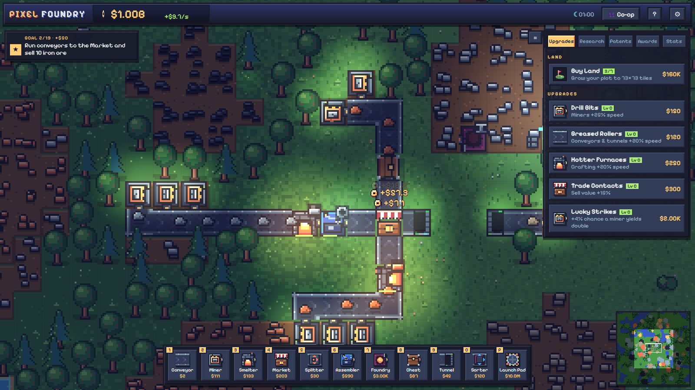
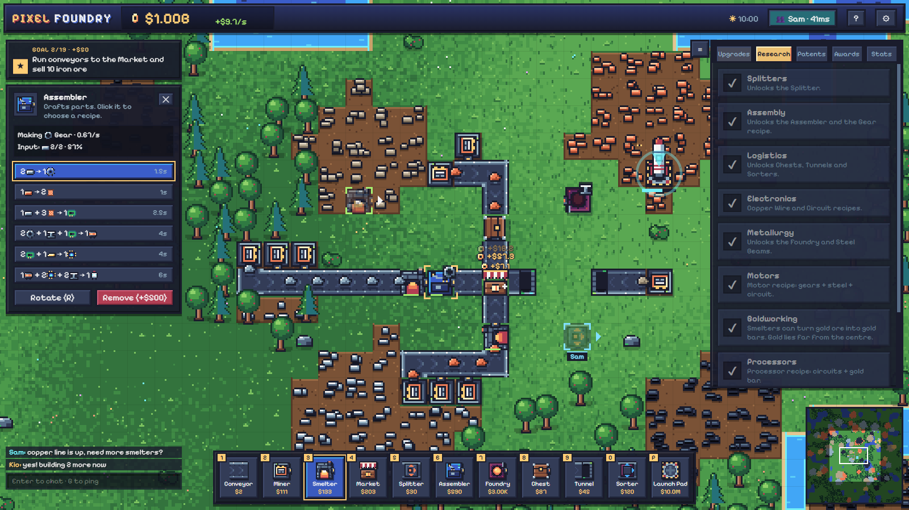
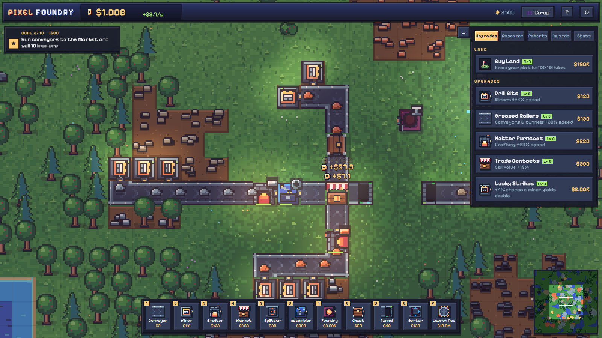
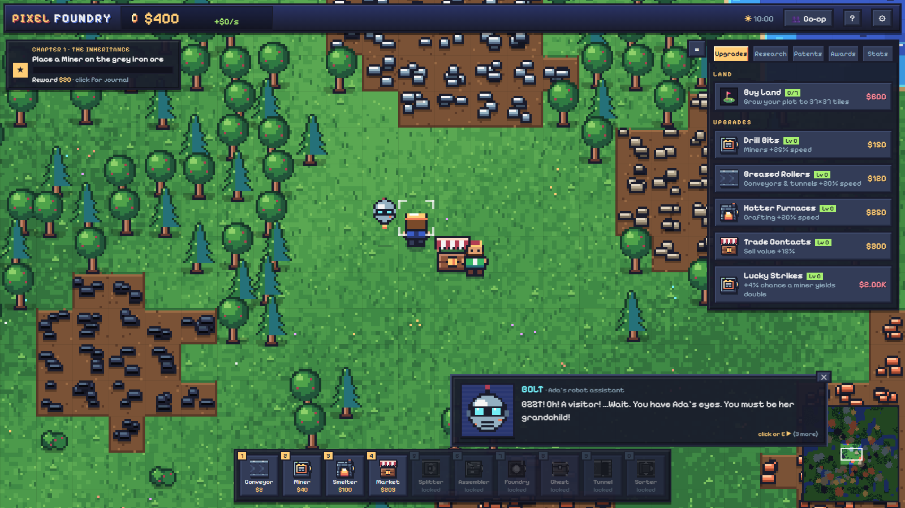
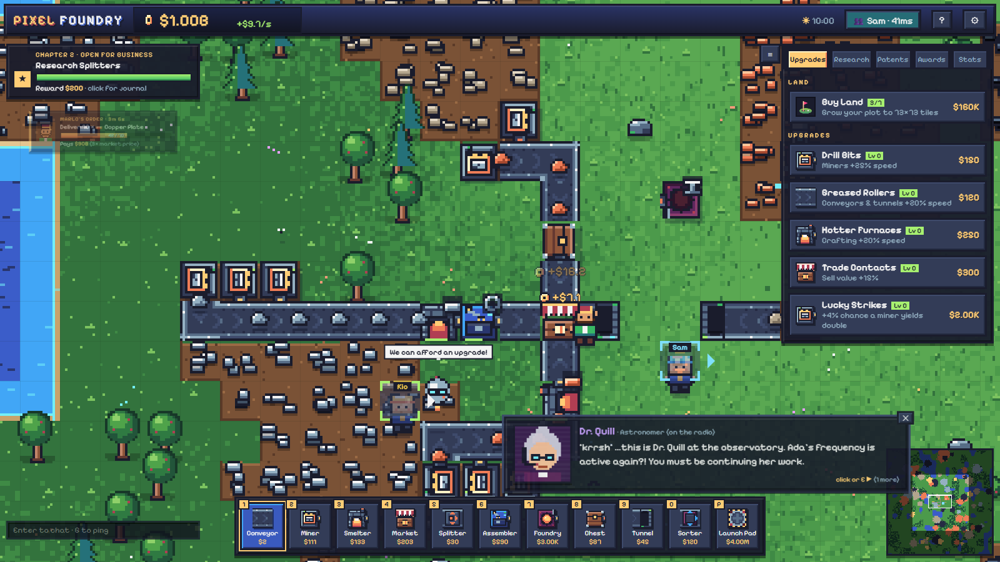

# Pixel Foundry

An incremental factory-building game with 2D pixel art. You can play solo or in **online 2-player co-op**.

Mine ore, run it along conveyors, smelt and assemble it into more valuable parts, and sell everything at the Market. Reinvest in upgrades, research and land. Your factory is never reset: finishing chapters, delivering Marlo's orders and launching rockets earn **Patents**, which permanently boost income and buy upgrades. The big goal is to feed robots into a Launch Pad and launch the **Orbital Foundry**, then keep launching to grow the station.

There are no assets or build step. All pixel art (one cohesive Sweetie 16-based palette), sound effects and music are generated in code. The world feels alive: swaying forests, shimmering ponds, drifting cloud shadows, birds, butterflies, and a day/night cycle where furnaces and lamps light up the dark, plus fireflies at night.


## Story & objective

You inherit Grandma Ada's overgrown island workshop and set out to finish her life's dream: the **Orbital Foundry**, a factory in space. The story plays out over **5 chapters** (The Inheritance → Open for Business → The Industrial Age → Gold Fever → Reach for the Stars), driven by 19 goals with progress bars and cash rewards. It ends when you launch the rocket.

**Characters:**
- **BOLT:** Ada's rusty robot assistant. He hovers beside you, gives tips, and comments on jams and spare cash.
- **Marlo:** the trader who runs the Market. He stands by his stall and posts **delivery orders**: deliver X items before the timer runs out and he pays 3× the market price.
- **Dr. Quill:** an astronomer who guides your research over the radio.
- **Grandma Ada:** appears through her letters.

Each player is a little engineer in a hard hat (gold for the host, cyan for the guest). Your engineer walks to wherever you point and swings a hammer when you build. Click the goal panel to reread the story in the **Journal**.

## Balance

`test/balance.html` runs a bot through the whole economy using the real numbers and prints when each milestone happens. Current pacing for a fast, near-optimal player: new research about every 10 minutes, $1K/s at about 1h20, first launch at about 3h (the bot ignores the 3× machines, so real runs can be quicker). Expect longer for a normal first playthrough, since you walk to build.

## Screenshots

| | |
| --- | --- |
|  |  |
| Title screen over the live world | A small factory by day |
|  |  |
| Night: furnaces and lamps light the dark | Co-op: partner cursor, chat, ping, research |
|  |  |
| Golden hour at dusk | Chapter 1: BOLT greets you, Marlo minds the Market |
|  | |
| Co-op engineers, BOLT tips, Dr. Quill on the radio, Marlo's order | |

## Play

**Play online:** https://kh-maintainer.github.io/game/ (GitHub Pages)


Open `index.html` in a browser, or serve the folder:

```sh
python -m http.server 8000   # then open http://localhost:8000
```

URL flags: `?new` ignores the save, `?demo&new` loads a pre-built test factory, and `?join=CODE` opens the join dialog with the room code filled in.

## Online co-op

1. Both players open the game and pick **Co-op**. The 👥 button in the top bar also opens it.
2. One player clicks **Host game** and shares the 5-letter room code.
3. The other player enters the code and clicks **Join**.

How it works:
- You build **one shared factory** with one wallet, and shared research, upgrades, land and patents.
- Each player sees the other's cursor, name and building ghost. Press **Enter** to chat, and **G** or **Alt+click** to ping a tile.
- It's peer-to-peer over WebRTC using [PeerJS](https://peerjs.com/). No game server is needed, but both players need an internet connection. PeerJS's free public broker is only used to set up the connection.
- The **host is authoritative**. Guest actions are sent to the host, which checks and applies them and sends them back. The host also sends a full state sync every 2 seconds.
- The host's save is the shared world. A guest's own solo save is kept safe and comes back when they leave.

## Controls

| Input | Action |
| --- | --- |
| `WASD` / arrows | Walk (`Shift` runs). The camera follows you. Stand on a conveyor to ride it |
| `1`–`9`, `0`, `V`, `B`, `Z`, `X`, `C`, `P` | Select a building |
| Left click / drag | Build within ~3 tiles of your character (dotted ring). Dragging conveyors bends the line to follow you |
| Right click / drag | Remove (full refund) |
| `R` / `Shift+R` | Rotate the ghost or the building under the cursor |
| `Q` | Pipette: copy the building under the cursor |
| Click a building | Inspect it, pick a recipe, set a sorter filter |
| `E` | Advance dialogue |
| Mouse wheel / `+` `-` | Zoom |
| `Enter` / `G` | Chat / ping (co-op) |
| `M` / `H` | Mute / help |

## Power

Basic Miners and Smelters need no power. Assemblers, Foundries, Deep Drills, Arc Furnaces and Fabricators draw MW from one shared grid:
- **Generators** burn coal (any side) for 20 MW each.
- **Solar Panels** make 8 MW with no fuel.

If demand is higher than supply, every powered machine slows down by the same ratio. The top bar shows `⚡ supply / demand`, and a lightning icon blinks over starved machines.

## Music

Five procedural chiptune tracks: Morning Shift, Gearworks, Gold Rush, Orbit and Night Furnace. They rotate automatically, and the calm Night Furnace plays after dark. You can pin one in Settings.

## Content

**Buildings:** Conveyor (curves automatically), Miner, Smelter, Market, Splitter, Assembler, Foundry, Chest (64-item buffer), Tunnel (underground, up to 5 tiles), Sorter (item filter), Launch Pad.

**Items:** iron/copper/gold ore, stone, coal → plates, bricks, gold bars → gears, wire, circuits, steel → motors, processors → robots.

**Progression:**
- 5 repeatable upgrades and 10 research nodes.
- 7 land expansions. Gold only appears far from the centre.
- 19 guided goals with cash rewards.
- 29 achievements, each giving +2% income.
- Patents (no reset): +2 per chapter finished, +1 per 10 orders delivered, +5 per launch. Each gives +5% income forever, and they can be spent on 7 permanent upgrades in the Patent Office.
- Endgame: rocket launches. Each one pays 5 patents and the next needs 50% more robots, so the station keeps growing.

**Quality of life:**
- Autosaves every 15s, with offline earnings (50% base, up to 8h).
- Save export/import, plus volume, mute and grid settings.
- A minimap, smoke and coin particles, buildings that pop in with a dust puff, and screen shake on liftoff.
- Settings toggles for the grid and the day/night cycle.

## Code layout

```
index.html        page shell (loads PeerJS from unpkg)
css/style.css     UI styling
js/data.js        items, recipes, buildings, upgrades, research, patents, achievements, goals
js/game.js        simulation: map gen, item flow, economy, power, patents, actions, save/load
js/audio.js       WebAudio synth SFX + procedural chiptune music
js/sprites.js     procedural pixel-art sprites and terrain
js/render.js      canvas renderer: camera, land, curves, particles, partner cursor, pings
js/net.js         online co-op over PeerJS (host-authoritative)
js/ui.js          DOM UI, input, panels, modals, minimap, chat
js/main.js        bootstrap and main loop
test/sim.html     headless simulation tests (open in a browser; 28 checks)
test/balance.html pacing bot: simulates a full run and prints milestone times
```

Every world change is a serialisable **action** (`Game.apply`). That one path is what lets solo play, the co-op host and the co-op guest share the same code.
