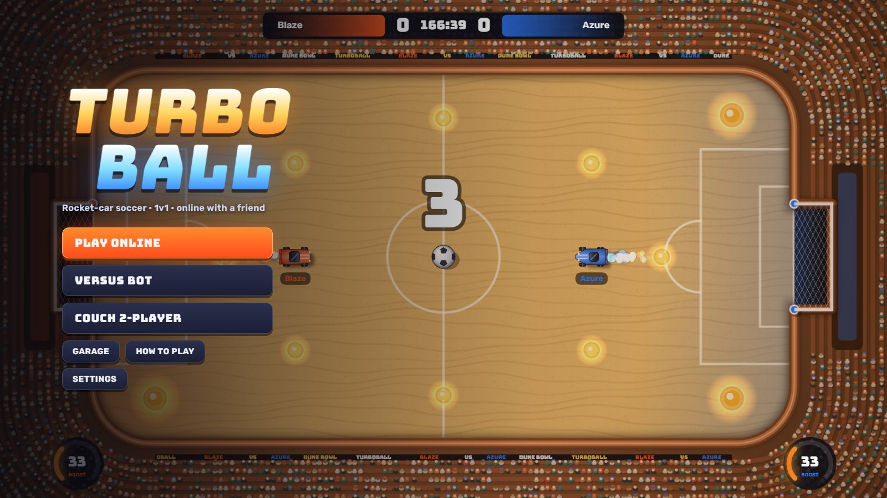
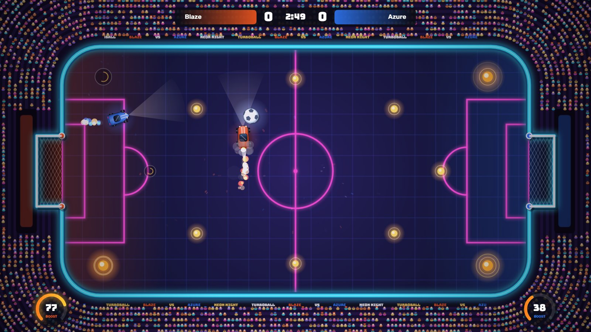
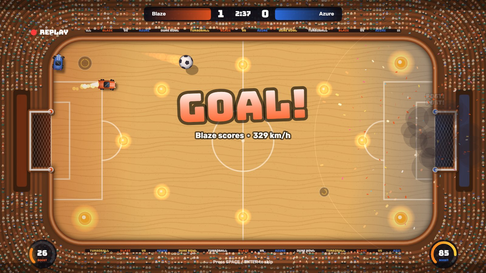
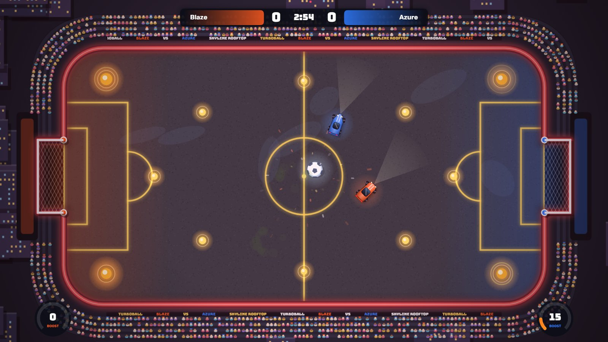
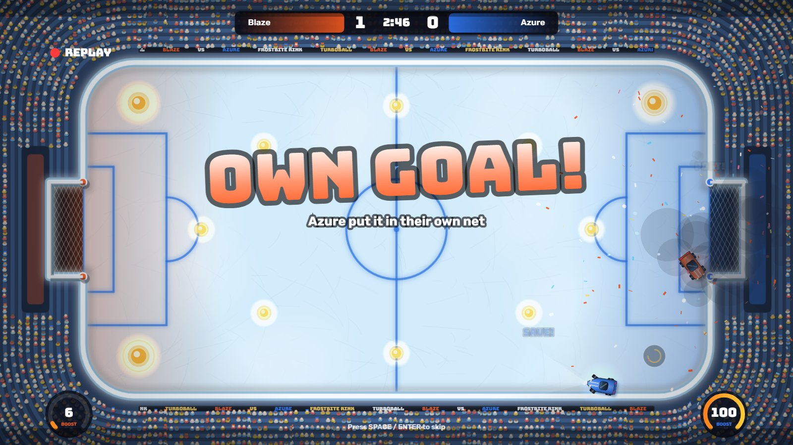
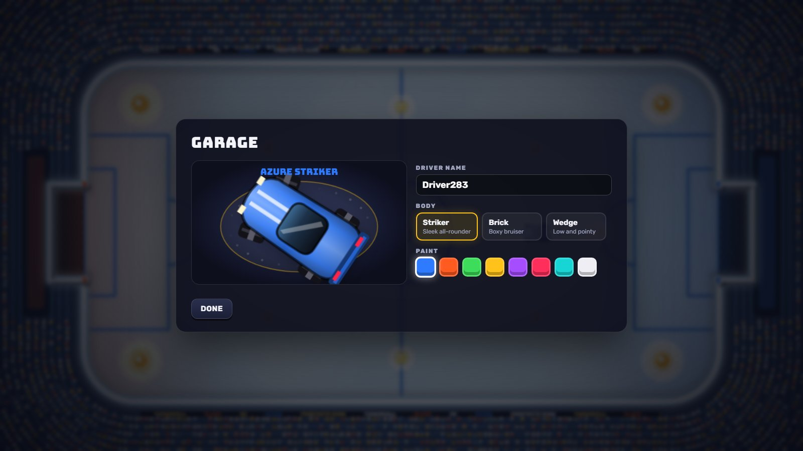
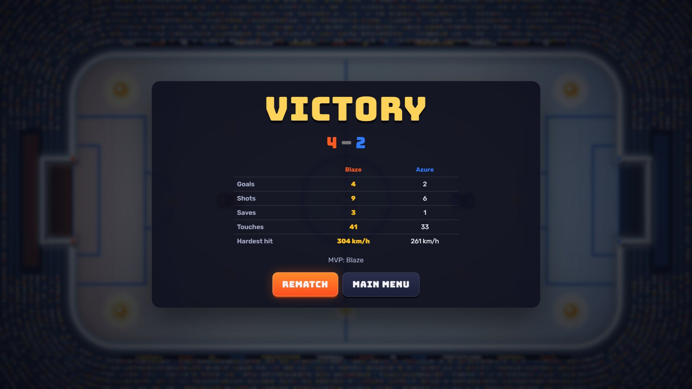

# Turboball

**Rocket-car soccer for two players, in the browser.** Drive, boost, hop and smash a giant ball into your friend's goal. Play online with a friend over a 4-letter room code, against a bot, or two players on one keyboard.

There are no assets and no build step. Every car, stadium, crowd and particle is drawn in code, and every sound effect and all 8 music tracks are synthesized live with WebAudio.

| | |
| --- | --- |
|  |  |
| Neon Night: headlights, glowing lines | Goal explosion, confetti, crowd going wild |
|  |  |
| Skyline Rooftop above the city | Instant replay after every goal (Frostbite Rink) |
|  |  |
| Garage: 3 bodies × 8 paints | Post-match stats and MVP |

## Play

Serve this folder (or the whole repo) from any static host, e.g. GitHub Pages, and open `turboball/`.

**Online with a friend:** *Play Online → Create room*, then send your friend the 4-letter code or the invite link. When they join, pick an arena and press *Start match*. The connection is peer-to-peer WebRTC (via the free PeerJS broker). There's no game server.

## Controls

| | Keyboard | Gamepad |
| --- | --- | --- |
| Drive / reverse | `W` `S` (or arrows) | RT / LT |
| Steer | `A` `D` (or arrows) | Left stick |
| Boost | `Shift` / left mouse | B, X or RB |
| Hop (steer for a side flip, hold back for a back flip) | `Space` / right mouse | A |
| Quick chat | `1`–`5` | |
| Skip replay | `Space` / `Enter` | |
| Menu | `Esc` | |

Couch 2-player: P1 uses `WASD` + `Left Shift` + `Space`; P2 uses arrows + `Right Shift` (or `/`) + `Enter`.

## What's in it

- **5 arenas** with their own look, physics and music: Sunset Park (grass), Neon Night (synthwave), Frostbite Rink (ice: you slide and the ball flies), Dune Bowl (sand: heavy ball, big drifts), Skyline Rooftop (asphalt above the city).
- **Arcade car physics:** grip and drift, boost, hops and flips that pop the ball into the air, car-on-car bumps, and a ball that flies in 3D with a shadow and real rolling patches.
- **12 boost pads**, kickoff countdown, overtime golden goal, instant goal replays, slow-motion goal explosions, a crowd that jumps and roars, skid marks, scrolling LED boards.
- **Bots** at three levels (Rookie, Pro, Legend) that rotate, shadow-defend, grab boost, shoot and save.
- **Soundtrack:** 8 original synthwave/chiptune tracks (title, garage, one per arena, sudden-death overtime) plus goal, victory and defeat jingles. The jukebox is under *Settings*.
- Synthesized SFX with stereo panning: engines that rev with speed, boost roar, ball hits, post "ooh"s, stadium horn, referee whistle.

## Netcode

The host runs the authoritative match: ball, score, pads and clock. Each player drives their own car locally, so controls feel instant. The guest predicts the ball locally and blends toward the host's snapshots (30 Hz). Both sides lag-compensate the other player's car, so 50/50 challenges are fair. A worker timer keeps the match running if the host switches tabs.

## Tests

Open in a browser (or run headless Chrome with `--dump-dom`):

- `test/test.html`: bot-vs-bot matches on every arena (goals happen, nothing escapes the walls, matches finish, Legend beats Rookie), music track integrity, and a full host/guest match over a simulated 50 ms link.
- `test/net.html`: real WebRTC host and guest in one page through the PeerJS broker (needs internet; reports in the page title).
- `test/audio.html`: plays every sound effect, track and jingle and reports any WebAudio errors.

Debug URL parameters: `?demo=<arena>&warp=<seconds>` shows a live bot match; `?loopguest=<arena>` shows the guest's view over a fake 60 ms link.
